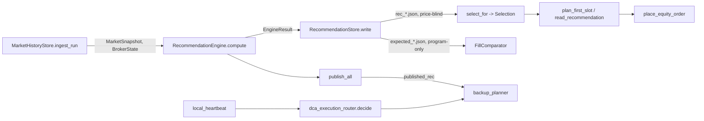

# Object-model roadmap and the architecture map

Written 2026-10-17 from a review of the last 8 days (116 commits). Companion to `docs/repo_map.md`.

## What actually changed

There was no repo-wide object-oriented refactor. The object-based shift is concentrated in the **plan-first
recommendation pipeline** (PR #1667 and follow-ups). The three older entry points (`run_dca.run_slot`, the
`MorningDCAExecutor` family, `dca_runner`) keep their procedural, dict-driven shape.

| Layer | Objects |
| --- | --- |
| Values (frozen dataclasses, `dca_rec_models.py`) | `MarketSnapshot`, `BrokerState`, `Recommendation`, `RecommendationSet`, `ExpectedPrice`, `ExpectedPriceSet` |
| Small results/config | `RecommendationSettings`, `Selection`, `EngineResult`, `PublishResult`, `FillRow` |
| Services | `RecommendationEngine`, `RecommendationStore`, `MarketHistoryStore`, `FillComparator` |
| Protocols | `Publisher` (Notion, GitHub branch), `MarketSource` (`AgentFetchSource`, unwired) |
| Executor routing | `ExecutorRole`, `LocalStatus`, `Decision`, `Heartbeat` in `dca_execution_router.py` |

## Flow

## Where it still passes more than it needs

1. `RecommendationEngine.compute` takes whole `MarketSnapshot` / `BrokerState` and uses about six fields.
2. "Frozen" objects carry mutable dicts: `MarketSnapshot.payload`, `ExpectedPriceSet.budget`,
   `RecommendationSet.sizing_guard`, `RecommendationSettings.publish`.
3. Engine-to-planner control flow is still raw dicts (candidates, plans, orders, routing-log rows).
4. `plan_first_slot` loads a whole `ExpectedPriceSet` to read one `.budget` dict by string key.
5. Layering inversion: library modules import the private `_order_of` from `scripts/validate_native_placement`.
6. Private helpers cross modules (`dop._fail`, `_spread_reason`, `_quote_sides`).
7. `_validate_plan_first` duplicates `validate_plan`; `_Refused` is defined twice.
8. Unwired: `AgentFetchSource`/`MarketSource`, `guard_broker`, `ExecutorRole.CLOUD`, `fallback_plan_source`.
9. Stale watchlist/09:45 comments remain in `morning_dca.py`.
10. The three entry points still seed caps from three sources, so a cap fix can drift.

## Phased path (each phase is its own reviewed change)

1. Typed `Order`/`Plan` objects replace dicts at the engine-to-planner boundary.
2. Narrow `compute()` inputs to the fields it reads.
3. Move shared helpers out of `scripts/` into the library; make the private ones public or inline them.
4. Wire up or delete the dead code in item 8; sweep the stale comments in item 9.
5. Only then consider consolidating the entry points. CLAUDE.md treats that as a decision with its own acceptance run.

## The architecture map (diagnostic, not shipped)

`dca_console_diagnostics.py` does a static `ast` read of the checkout (nothing imported or executed) and the console
serves it at `/diagnostics/architecture`, linked from the sidebar ("Architecture map"). It shows modules by layer,
import edges, classes with fields, function signatures, private cross-imports, dict-typed parameters and modules
nobody imports. Limit: `obj.method()` calls on instances are not resolved, so call edges under-count.

It is listed under "Deliberately NOT listed" in `pyproject.toml`, like the rest of the console, so it never ships.
